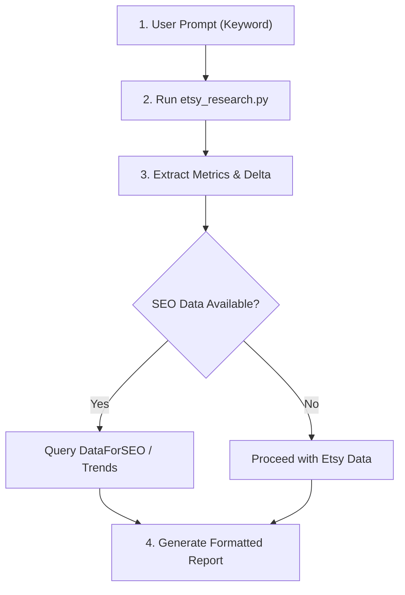

# Badem Rank — Etsy Market Research & SEO Intelligence Skill

## 🎯 Overview

This skill equips AI agents (Claude Code, Cursor, Codex, etc.) with the capability to perform deep, data-driven market research on Etsy. It enables agents to evaluate product niches, track competitor sales velocity without a paid Etsy API, identify high-converting tag patterns, and formulate pricing strategies.

---

## 🛠️ When to Use This Skill

Activate this skill whenever a user asks:
- *"Analyze the 'crochet bag' niche on Etsy."*
- *"What tags should I use for handmade soy candles?"*
- *"How fast are listings in this category getting reviews/sales?"*
- *"What is the optimal price point and competition level for digital planners?"*
- *"Do an overnight competitor sales check for my target keywords."*

---

## 🚀 Agent Execution Workflow

When invoked, the agent should follow this 4-step pipeline:



### Step 1: Run the Scraping & Analysis Script
Run the included standalone script from the skill directory:
```bash
python scripts/etsy_research.py --keyword "YOUR_KEYWORD" --pages 2
```
* The script outputs a clean JSON summary containing:
  * **Market Metrics:** Average price, price range (min/max), Star Seller ratio, total listings found.
  * **Top Performing Tags:** Most frequently used tags by top-ranked items and their average price correlation.
  * **Listing Snapshot:** Titles, prices, review counts, favorite counts, shop age, and listing URLs.
  * **Delta Calculation (if run multiple times):** Compares with previous runs and computes review/favorite deltas to estimate sales velocity.

### Step 2: (Optional) SEO Enrichment via Agensi Tools
If Agensi tools are enabled, call the DataForSEO tool to fetch search volume and CPC:
- Tool: `dataforseo.google.keywords.volume` or `dataforseo.x.keywords-data-clickstream-data-bulk-search-volume-live`
- Query the user's primary keyword and the top 3 discovered tags to get monthly search volumes.

### Step 3: Deliver the Market Intelligence Report
Format the output into the structured format shown below (see `references/example_report.md` for a complete example).

---

## 📋 Required Report Structure

Always present the findings to the user with the following sections:

### 1. 📊 Market Overview
- **Analyzed Keyword:** Primary query
- **Price Range:** Min / Median / Max price points
- **Competition & Saturation:** Star Seller percentage, average review counts

### 2. 🏷️ Top Tag & Keyword Opportunities
- List top 5-10 tags found in leading listings
- Highlight high-margin tag combinations (e.g., *"listings with 'gift for her' average \$12 higher"*)

### 3. ⚡ Sales Velocity (Delta Proxy)
- Highlight which listings are actively gaining reviews and favorites
- Estimate daily sales pace based on review velocity (typical Etsy ratio: 1 review ≈ 10 to 20 sales)

### 4. 💡 Strategic Recommendations for Seller
- **Pricing Strategy:** Recommended launch price vs mature price
- **Title & Tag Blueprint:** Suggested 13-tag layout
- **Niche Gaps:** Gaps where competition is low but price realization is high

---

## 📦 Package Contents

| Path | Description |
|---|---|
| `SKILL.md` | Skill manifest and execution instructions |
| `scripts/etsy_research.py` | Self-contained Etsy scraping and statistical engine (Python) |
| `references/example_report.md` | Reference markdown output template |
| `references/etsy_seo_guide.md` | Algorithmic ranking rules for Etsy search |

---

## ⚙️ Requirements
- Python 3.9+
- `httpx`, `beautifulsoup4`, `fake-useragent`
- Zero external database required — stores snapshots locally in `data/snapshots.json`.
